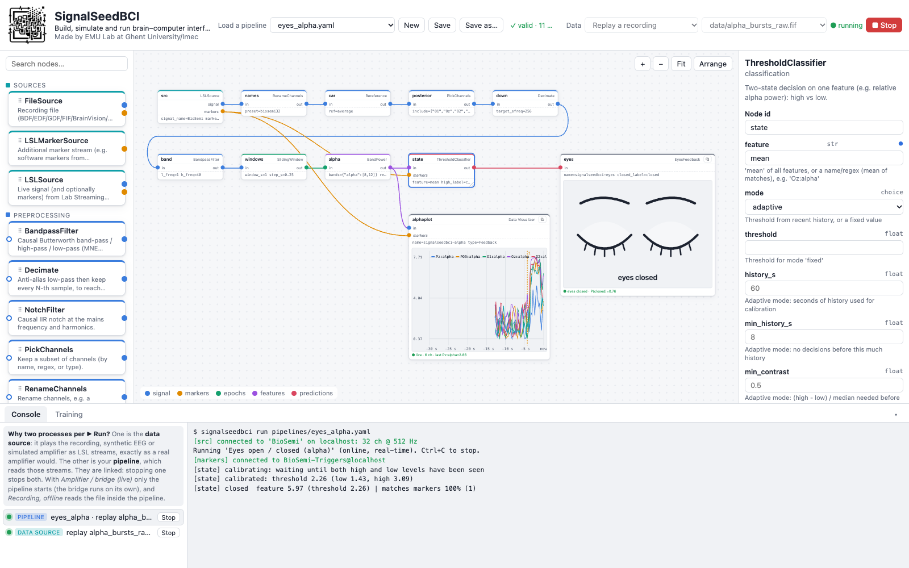
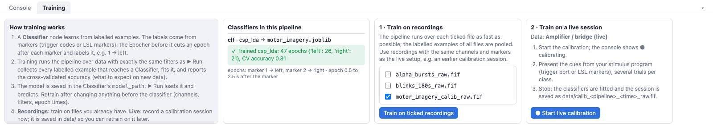
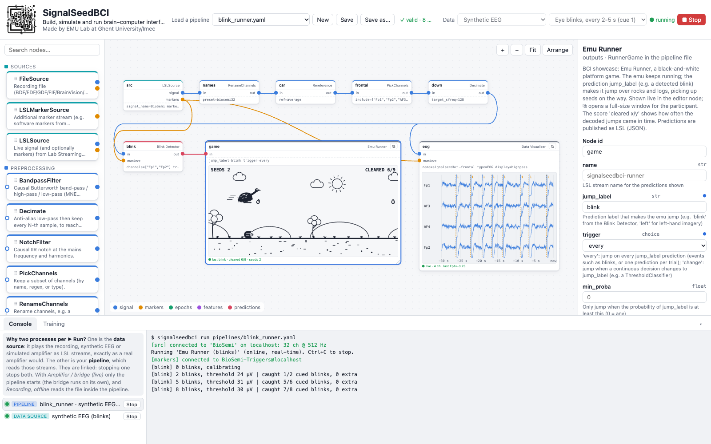
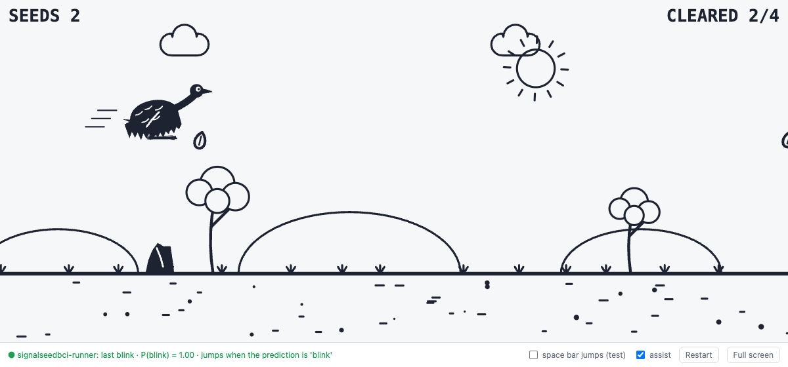

<p align="center">
  <picture>
    <source media="(prefers-color-scheme: dark)" srcset="docs/logo-dark.png">
    
  </picture>
</p>

<h1 align="center">SignalSeedBCI</h1>

Build, simulate and run brain–computer interface (BCI) pipelines in the browser, on macOS
or Windows, with or without an amplifier. Made by EMU Lab at Ghent University / imec.

- **Visual pipeline editor**: drag processing steps onto a canvas, connect them, press ▶ Run,
  and watch signals, spectra, classifier output and feedback live inside the nodes.
- **One pipeline for every kind of data**: live from an amplifier, a replayed recording
  (BDF/EDF/GDF/FIF/BrainVision/EEGLAB/XDF), synthetic EEG, or offline at full speed.
- **Training built in**: fit classifiers on recordings or in a live calibration session,
  with the same preprocessing that runs online.
- **Python all the way down**: MNE/SciPy preprocessing, scikit-learn/pyRiemann classifiers,
  and your own Python functions as pipeline steps.
- **Open by design**: everything travels over [Lab Streaming Layer](https://labstreaminglayer.org)
  (LSL), so PsychoPy, LabRecorder, Unity and other tools can send markers or read results.
- **Hardware support**: a bridge for the BioSemi ActiveTwo; any other LSL-capable device works too.

The command is **`signalseedbci`** (short: **`ssbci`**).


*The editor running `eyes_alpha.yaml` on a replayed recording: node tiles on the left, the
pipeline on the canvas with live views (a Data Visualizer plotting alpha power, animated eyes that
close when alpha is high), the selected node's settings on the right, and the Console below with
the run's two processes.*

## Contents

1. [How it works](#how-it-works)
2. [Installation](#installation)
3. [Quick start](#quick-start)
4. [The editor](#the-editor)
5. [Training a classifier](#training-a-classifier)
6. [Pipelines](#pipelines)
7. [Command line](#command-line)
8. [Example: Emu Runner](#example-emu-runner)
9. [Hardware: BioSemi ActiveTwo](#hardware-biosemi-activetwo)
10. [Extending it with Python](#extending-it-with-python)
11. [Development](#development)
12. [Credits](#credits)

## How it works

```
 data source                    LSL streams                 pipeline (graph of nodes)
 ───────────                    ───────────                 ─────────────────────────
 amplifier bridge  ─┐
 replayed recording ├──►  signal "BioSemi"            ──►  source → filters → epochs/windows
 synthetic EEG      │     markers "BioSemi-Triggers"        → features → classifier → outputs
 other LSL devices ─┘                                              │
                                                                   └──► LSL out (plots, feedback,
                                                                        PsychoPy, Unity, …)
```

1. **Every data source publishes the same LSL streams**: a signal stream and a marker
   (trigger) stream. A pipeline therefore cannot tell a live amplifier from a replay or a
   simulation, and the same pipeline runs on all of them. (The default names come from the
   BioSemi bridge; any names can be set in the `LSLSource` node.)
2. **A pipeline is a graph of nodes**, saved as a YAML file in `pipelines/`. Each node has
   typed inputs and outputs; connections carry one of five kinds of data:

   | Kind | What it is |
   |---|---|
   | `signal` | continuous multichannel data in µV, with channel names and sampling rate |
   | `markers` | time-stamped events, e.g. trigger codes `1`, `2` |
   | `epochs` | pieces of signal cut around markers (or sliding windows), each with a label |
   | `features` | a vector of numbers per epoch, e.g. band powers |
   | `predictions` | a classifier decision: label + probability per class |

3. **The graph runs in ticks**: every 20 ms each node, in order, processes what arrived from
   the nodes before it. All filters are **causal** (they use only past samples) and keep their
   state between chunks, so live processing gives exactly the same result as processing the
   whole recording.
4. **Run modes**: *online* (live LSL streams, real time), *replay* (a file at real-time pace)
   and *offline* (a file as fast as possible, for training and evaluation).
5. **Training** runs the pipeline over labelled data, collects the examples that reach each
   `Classifier` node and fits it; online, the same nodes load the model and predict
   (see [Training a classifier](#training-a-classifier)).

## Installation

Needs [uv](https://docs.astral.sh/uv/) (it installs Python 3.12) and a modern browser.

**macOS / Linux**

```bash
curl -LsSf https://astral.sh/uv/install.sh | sh        # or: brew install uv
git clone https://github.com/kbombeke/SignalSeedBCI.git
cd SignalSeedBCI
uv venv --python 3.12 .venv
uv pip install --python .venv -e ".[dev]"              # dev: + pyRiemann, XDF support, pytest
source .venv/bin/activate                              # once per terminal window
signalseedbci --version
```

**Windows**: clone or download the repository, open PowerShell in the folder and run
`powershell -ExecutionPolicy Bypass -File windows\install.ps1`. It installs uv, Python and
SignalSeedBCI into `.venv`, and opens the LSL ports in the firewall (run as Administrator for
that part). Afterwards, double-click `windows\start-editor.cmd` to start the editor; for other
commands activate the environment with `.venv\Scripts\Activate.ps1`.

**Updating**: `git pull`, then rerun the install command.

## Quick start

No hardware needed:

1. Start the editor: `signalseedbci gui` (Windows: `windows\start-editor.cmd`). It opens
   <http://localhost:8765> and serves the project in the current folder (`pipelines/`, `data/`,
   `models/`). Keep the terminal open; Ctrl+C stops it.
2. **Load a pipeline** › `eyes_alpha.yaml`.
3. **Data** › *Replay a recording* › **＋ Create synthetic recording…** › *Alpha bursts*,
   180 s › Create. This writes a recording with strong alpha for 10 s every 20 s.
4. Press **▶ Run**. Within about 20 s the eyes in the `eyes` node close during the alpha
   bursts and open between them. Press **■ Stop** when done.

## The editor

The screenshot at the top shows the layout.

- **Toolbar**: load, create and save pipelines (⌘S saves); the validation status (hover for all
  problems); **Data**, where the data comes from when you press ▶ Run:

  | Data | ▶ Run starts |
  |---|---|
  | Amplifier / bridge (live) | the pipeline on the live LSL streams |
  | Replay a recording | the recording as LSL streams (looping) + the pipeline |
  | Synthetic EEG | synthetic EEG (motor imagery, alpha bursts or eye blinks) + the pipeline |
  | Simulated ActiveTwo | a simulated amplifier through the real BioSemi decoder + the pipeline |
  | Recording, offline | the pipeline over the file as fast as possible (evaluation) |

- **Palette** (left): drag a node tile onto the canvas, or select a node and click a tile to
  add and connect the next step.
- **Canvas**: drag from an output dot (right) to an input dot (left) to connect; colours show
  the data kind and connections that don't fit are refused. Drag a node's corner to resize it;
  output nodes show a **live view** (Data Visualizer plots, spectrum, eyes) that becomes a full
  plot once the node is large enough, and **⧉** opens it in its own window. Delete, ⌘D, ⌘Z / ⇧⌘Z,
  scroll to pan, pinch or ⌘-scroll to zoom.
- **Inspector** (right): the selected node's settings, each with an explanation; ● marks values
  that differ from the default.
- **Bottom panel**: the **Console** (output and Stop buttons of every process) and the
  **Training** tab. A ▶ Run usually shows two linked processes: the *data source* (replay,
  synthetic or simulated amplifier) and the *pipeline* that reads it; stopping one stops both.
- **Panels**: drag the edges between the panels to resize them, drag a panel shut to hide it
  (click its edge to bring it back), double-click an edge to reset. Sizes are remembered.

## Training a classifier

Pipelines with a `Classifier` node learn from labelled data before ▶ Run can use them
(pipelines without one, such as `eyes_alpha.yaml`, run directly).

1. **Labels come from markers.** An `Epocher` before the classifier cuts an epoch after each
   marker in its `events` and labels it, e.g. marker `1` → `left`, `2` → `right`.
2. **Training runs the pipeline** over data with exactly the same preprocessing as ▶ Run,
   collects every labelled example that reaches a `Classifier`, fits it and reports the
   cross-validated accuracy.
3. **The model is saved** in the classifier's `model_path`; ▶ Run loads it. It remembers the
   channels, sampling rate and epoch length it was trained on and refuses different input, so
   retrain after changing anything before the classifier.

In the editor, the **Training** tab shows each classifier's state and offers two ways to train:

- **Train on recordings**: tick files in the project (e.g. in `data/`) and train. Examples
  from several files are pooled.
- **Train on a live session**: with a streaming Data source, start the calibration, present
  the cues (trigger port or LSL markers), then stop. The classifiers are fitted and the raw
  session is saved as `data/calib_<pipeline>_<time>_raw.fif`, to retrain on later.


*The Training tab for `motor_imagery.yaml`: how training works, the classifier's state (trained,
cross-validated accuracy, which markers give which labels), and the two ways to train.*

On the command line:

```bash
signalseedbci train pipelines/motor_imagery.yaml --data data/calib_raw.fif   # recordings
signalseedbci train pipelines/motor_imagery.yaml --live                      # live, until Ctrl+C
signalseedbci run   pipelines/motor_imagery.yaml --offline data/test_raw.fif # evaluate
```

## Pipelines

Pipelines are plain YAML; the editor reads and writes the same files. Paths are relative to the
pipeline file.

```yaml
name: My pipeline
nodes:
  src:    {type: LSLSource, params: {signal_name: BioSemi, marker_name: BioSemi-Triggers}}
  car:    {type: Rereference, params: {ref: average}}
  band:   {type: BandpassFilter, params: {l_freq: 8, h_freq: 30}}
  epochs: {type: Epocher, params: {events: {"1": left, "2": right}, tmin: 0.5, tmax: 2.5}}
  clf:    {type: Classifier, params: {estimator: csp_lda, model_path: ../models/mi.joblib}}
edges:
  - src.signal -> car.in
  - car.out -> band.in
  - band.out -> epochs.in
  - src.markers -> epochs.markers
  - epochs.out -> clf.in
```

**Nodes** (the editor explains every setting; `signalseedbci nodes` lists them):

| Category | Nodes |
|---|---|
| Sources | `LSLSource` (live streams), `LSLMarkerSource` (extra markers, e.g. PsychoPy), `FileSource` (a recording; swapped in automatically for replay/offline) |
| Preprocessing | `PickChannels`, `RenameChannels`, `Rereference`, `BandpassFilter`, `NotchFilter`, `Decimate` |
| Epoching | `Epocher` (around markers), `SlidingWindow` (continuous decoding) |
| Features | `BandPower`, `TimeWindowMeans` |
| Classification | `Classifier` (`csp_lda`, `ts_lr`, `mdm`, `xdawn_ts_lr`, `lda`, or your own), `ThresholdClassifier` (high/low on one feature, self-calibrating, no training), **Blink Detector** (`BlinkDetector`: a `blink` prediction per eye blink in frontal/EOG channels, adaptive threshold, no training) |
| Outputs | **Data Visualizer** (`DataVisualizer`: live plot + LSL stream), `SpectrumOut`, `EyesFeedback`, `GazeFeedback`, **Emu Runner** (`RunnerGame`, a game, see [the example](#example-emu-runner)), `PredictionOut` (JSON predictions over LSL), `Recorder` (.fif), `Logger` |
| Scripting | `SignalScript`, `EpochScript` (see [Extending it with Python](#extending-it-with-python)) |

**Examples** in `pipelines/`:

| Pipeline | What it does |
|---|---|
| `eyes_alpha.yaml` | Eyes close when posterior alpha is high, open when low (no training) |
| `alpha_neurofeedback.yaml` | Relative alpha power and a live spectrum as LSL streams |
| `motor_imagery.yaml` | Left vs right hand imagery with CSP + LDA (train first) |
| `blink_runner.yaml` | Emu Runner: blink to make the emu jump (Blink Detector on Fp1/Fp2, no training) |
| `Exp2_replay_attempt1.yaml` | In-ear EOG from a recorded session: mastoid reference, 128 Hz, 10 Hz low-pass, live plot |

## Command line

`signalseedbci --help` lists everything; recordings may be `.bdf .edf .gdf .fif .vhdr .set .xdf`.

| Command | Purpose |
|---|---|
| `gui` | Start the editor |
| `run P.yaml [--replay REC \| --offline REC]` | Run a pipeline on live LSL, a file in real time, or a file as fast as possible |
| `train P.yaml --data REC… \| --live` | Fit the pipeline's classifiers |
| `replay REC [--loop]` | Publish a recording as LSL streams |
| `synth [--paradigm alpha-bursts\|blinks] [--record FILE]` | Stream synthetic EEG, or write a synthetic recording |
| `bridge biosemi \| actiview` | BioSemi ActiveTwo → LSL (see below) |
| `discover [--check]` | List LSL streams on the network |
| `lsl-config --peers IP…` | Configure LSL for networks where discovery fails |
| `nodes [--json]` | List node types and their settings |

## Example: Emu Runner


*`blink_runner.yaml` running on synthetic blinks: the emu in the `game` node leaps when a blink is
detected, the `eog` node shows the frontal channels with a line at each cued blink, and the
Console reports how many cued blinks the Blink Detector caught.*

Emu Runner shows a complete BCI loop on one screen: a signal comes in, a decision is decoded,
and the decision acts in a game. An emu runs through the outback by itself; the participant makes
it jump over rocks and logs by **blinking**. No training is needed.

**The pipeline**, `pipelines/blink_runner.yaml`:

| Node | Type | What it does |
|---|---|---|
| `src` | LSLSource | the EEG and trigger streams (amplifier, replay or simulation) |
| `names` | RenameChannels | BioSemi labels A1…A32 → 10-20 names (Fp1, Fp2, …) |
| `car` | Rereference | common average reference |
| `frontal` | PickChannels | Fp1, Fp2, AF3, AF4, where blinks are largest |
| `down` | Decimate | 512 → 128 Hz |
| `blink` | Blink Detector | one `blink` prediction per blink: Fp1/Fp2 averaged, band-passed (0.5–10 Hz) and compared with a threshold that adapts to the person |
| `game` | Emu Runner | the game: every `blink` prediction makes the emu jump |
| `eog` | Data Visualizer | the frontal channels with the trigger markers |

**Try it without hardware**: Load a pipeline › `blink_runner.yaml`, Data › *Synthetic EEG* ›
*Eye blinks*, ▶ Run. The simulation blinks every 2–5 s and marks each blink with trigger `1`.
After about 3 s of calibration the Blink Detector starts and the Console reports e.g.
`caught 7/8 cued blinks, 0 extra`. Click **⧉** on the `game` node for the full-size game:



The simulated blinks come at random moments, not when an obstacle approaches. With **assist**
(on by default) a jump command is held for up to 2.5 s and fired at the right moment for the next
obstacle, so a blink in that window still clears it; other obstacles are hit.

**With a participant**: record from Fp1/Fp2 (or a vertical EOG pair; then set the Blink
Detector's `channels` to that channel). Open the game window on a screen the participant sees,
click *Full screen* (double-click hides the bar) and ask them to blink when an obstacle comes.
Natural blinks also make the emu jump; that is part of the challenge.

- **Score**: *SEEDS* are picked up on a good jump and lost on a hit; *CLEARED x/y* counts the
  obstacles cleared out of those reached, a simple measure of how well the BCI worked.
- **Tuning**: raise the Blink Detector's `threshold_sd` if eye movements cause jumps, lower it if
  blinks are missed. In the game node, `crossing_s` sets the speed and `assist: false` makes it
  harder. The window's *space bar jumps* mode tries the game without a BCI.
- **Other decoders**: any prediction can drive the emu via `jump_label` and `trigger`, e.g.
  `left` from a motor-imagery Classifier (`trigger: every`, one prediction per trial) or `closed`
  from an alpha ThresholdClassifier (`trigger: change`, jump when the decision switches).

## Hardware: BioSemi ActiveTwo

Any device that streams over LSL works with an `LSLSource`. For the BioSemi ActiveTwo,
SignalSeedBCI includes a **bridge** that publishes the amplifier as the LSL streams `BioSemi`
(signal, µV) and `BioSemi-Triggers` (trigger codes, sample-accurate):

- `signalseedbci bridge biosemi --channels 64`: reads the amplifier through BioSemi's USB
  driver (`Labview_DLL`, Windows; close ActiView first). Speed mode, sampling rate, CMS and
  battery status are read from the amplifier.
- `signalseedbci bridge actiview --tcp-channels N --sfreq F`: reads ActiView's TCP server, so
  ActiView keeps the amplifier.
- `--fake` simulates an ActiveTwo, to test the whole path without hardware.

The amplifier's driver is Windows-only, so the bridge runs on the Windows computer the
amplifier is plugged into (`windows\start-bridge.cmd`). The pipeline can run on the same
computer or on a Mac on the network; `signalseedbci discover --check` shows whether the streams
arrive (if not, see `signalseedbci lsl-config`). BioSemi records reference-free: always add a
`Rereference` node.

The USB protocol handling is tested against a simulated amplifier but not yet verified on every
hardware revision: on first use, check that the bridge reports the expected speed mode, channel
count and sampling rate, and compare one signal with ActiView.

## Extending it with Python

- **`SignalScript`**: a file with `process(data, times, info, state)`, called on each chunk of
  continuous signal (µV, channels × samples); it must be causal.
- **`EpochScript`**: `process(epoch_data, meta, state)`, called per epoch; return `None` to
  reject it. The natural place for MNE functions (ICA, resampling, …); see
  `scripts/mne_epoch_cleaning.py`.
- **Your own classifier**: `estimator: path/to/file.py:make_estimator`, a function returning any
  scikit-learn estimator.
- **Your own node**: a class in `src/signalseedbci/pipeline/nodes/` that declares `inputs`,
  `outputs` and `params`; it appears in the editor and in `signalseedbci nodes` automatically.
- **Feedback programs** read predictions from LSL (`signalseedbci-predictions` by default) as
  JSON `{"label": ..., "proba": {...}}`.

## Development

```
src/signalseedbci/
├── pipeline/   graph engine and all nodes
├── gui/        editor server + static web app (no build step)
├── sources/    replay and synthetic EEG
├── bridge/     BioSemi USB / ActiView → LSL
├── cli.py      the signalseedbci command
└── models.py   built-in classifiers
pipelines/  examples      scripts/  example scripts      tests/  pytest suite      windows/  launchers
```

Run the tests with `pytest -q`; GitHub Actions runs them on macOS and Windows for every push.
Reload the editor page after editing its HTML/CSS/JavaScript. Recordings (`data/`) and trained
models (`models/`) are kept out of git.

## Credits

SignalSeedBCI is made by EMU Lab at Ghent University / imec. It builds on the work of many
open-source projects:

- **[OpenViBE](http://openvibe.inria.fr)**, the open-source BCI platform created at Inria by
  Anatole Lécuyer, Yann Renard and the OpenViBE team and contributors. Its approach of building
  acquisition, signal processing and feedback from connected boxes in a visual editor inspired
  this project, and its BioSemi ActiveTwo driver informed how the bridge handles the USB
  protocol and status bits. SignalSeedBCI contains no OpenViBE code.
- **[Lab Streaming Layer](https://labstreaminglayer.org)** (liblsl, pylsl) and its App-BioSemi,
  for streaming and time synchronisation.
- **[MNE-Python](https://mne.tools)**, **[SciPy](https://scipy.org)**,
  **[scikit-learn](https://scikit-learn.org)** and **[pyRiemann](https://pyriemann.readthedocs.io)**
  for signal processing and machine learning.
- **BioSemi** for documenting the ActiveTwo acquisition protocol.
